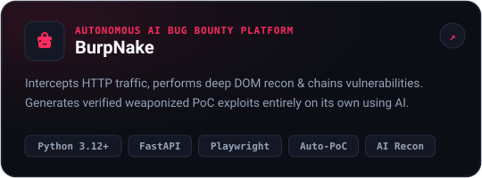
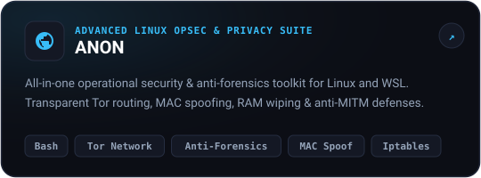

<!-- Hero Animated Terminal -->

  

<!-- Action Buttons -->
&nbsp;
&nbsp;

  

<!-- Featured Flagship Arsenals -->
<h3 align="center" style="font-family: monospace; letter-spacing: 1px;">
  ⚡ FEATURED ARSENALS &amp; WEAPONRY
</h3>

&nbsp;

  

<!-- Core Domains Table -->
<table width="100%" style="border-collapse: collapse; border: 1px solid #1f2536; background-color: #0c0e15; border-radius: 12px; margin-top: 10px;">
  <tr>
    <td width="33.3%" valign="top" style="padding: 18px; border-right: 1px solid #1f2536;">
      <h4 style="color: #ff2a5f; margin-top: 0; font-family: monospace;">▨ Offensive Security &amp; AI</h4>
      

        Otonom zafiyet keşfi, HTTP trafiği filtreleme, DOM tabanlı analiz ve birden fazla güvenlik açığını zincirleyerek PoC exploit üreten yapay zekâ modelleri.
      

    </td>
    <td width="33.3%" valign="top" style="padding: 18px; border-right: 1px solid #1f2536;">
      <h4 style="color: #38bdf8; margin-top: 0; font-family: monospace;">▨ OPSEC &amp; Anti-Forensics</h4>
      

        Linux ve WSL sistemlerinde şeffaf Tor yönlendirmesi, dinamik MAC spoofing, RAM temizleme (RAM wipe) ve anti-MITM savunmasıyla tam operasyonel gizlilik.
      

    </td>
    <td width="33.3%" valign="top" style="padding: 18px;">
      <h4 style="color: #00e599; margin-top: 0; font-family: monospace;">▨ Local AI &amp; Engineering</h4>
      

        İzole ve yerel donanımda koşan LLM/RAG yapıları (Ollama, Qwen), Python &amp; Bash temelli yüksek performanslı otomasyonlar ve sağlam mimariler.
      

    </td>
  </tr>
</table>

 

<!-- Profile Views Badge -->

